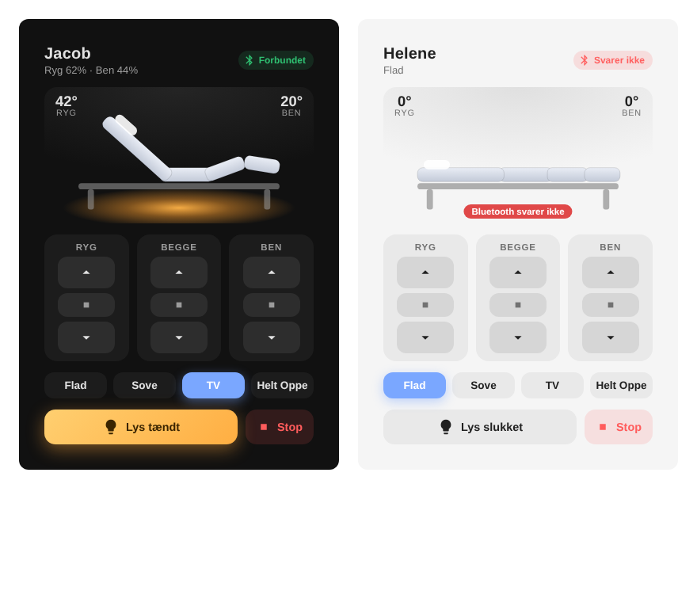

# LINAK Bed Card

[](https://hacs.xyz/)

A Home Assistant dashboard card for LINAK adjustable beds controlled over Bluetooth with ESPHome.



## Features

- **Live drawing of the bed.** The back and legs tilt to the real angles reported by the bed.
- **Under-bed light** with a warm glow when it is on.
- **Connection status**, with a red warning when the bed's Bluetooth stops responding.
- **Up / stop / down** for back, legs and both.
- **Preset buttons**, with the active preset highlighted.
- **Big stop button.**
- Follows your Home Assistant theme (light and dark), using theme variables for colours.
- Shows the active preset and clear loading / incomplete / unavailable states.
- Controls whose entities are missing or unavailable are disabled (or hidden), instead of being dead buttons.
- Accessible: labelled buttons, keyboard focus styles and arrow-key navigation between presets.
- Danish and English texts (follows your Home Assistant language).

## Installation

### HACS (recommended)

1. In HACS, open the menu (⋮) and choose **Custom repositories**.
2. Add this repository's URL and choose the category **Dashboard**.
3. Find **LINAK Bed Card** in HACS and download it.
4. Refresh your browser.

### Manual

1. Copy `linak-bed-card.js` to `/config/www/`.
2. Go to **Settings → Dashboards → ⋮ → Resources → Add resource**:
   - URL: `/local/linak-bed-card.js`
   - Type: **JavaScript module**

## Usage

1. Edit your dashboard and click **Add card**.
2. Search for **LINAK Bed Card**.
3. In the editor, choose the bed under **Seng (enhed)**.

That's it. The card finds the bed's entities on the device by itself, whatever the entity IDs are called, and reads the preset names from the bed's preset select.

Under **Avanceret: vælg entiteter manuelt** you can pick any entity by hand, if one isn't found automatically.

### YAML

The editor writes YAML like this:

```yaml
type: custom:linak-bed-card
name: Jacob
device: 0123456789abcdef0123456789abcdef
```

| Option     | Description                                                                 |
| ---------- | --------------------------------------------------------------------------- |
| `device`   | The bed's device ID. Entities are found on it automatically (recommended).  |
| `name`     | Title shown on the card. Defaults to the device name.                       |
| `entities` | Override individual entities (see below).                                   |
| `presets`  | Preset names. Default: the options of the bed's preset select.              |
| `prefix`   | Older alternative to `device`: entity ID prefix, e.g. `jacob_seng`.         |
| `language` | `da` or `en`. Default: your Home Assistant language (English if unsupported). |

Keys for `entities`: `back_cover`, `legs_cover`, `both_cover`, `back_angle`, `legs_angle`, `light`, `connection`, `problem`, `preset`, `stop`.

### Two beds in one card

Give the card one entity from each bed (any entity of the bed works, e.g. its head cover). The other entities are found on the same device, or by the entity ID prefix. The single-bed config above is unchanged.

```yaml
type: custom:linak-bed-card
entity_a: cover.jacob_seng_head
entity_b: cover.helene_seng_head
name_a: Jacob # optional
name_b: Helene # optional
control_mode: single # optional: single (default) or linked
```

A **Single / Linked** toggle appears on the card:

- **Single:** controls one bed. Pick bed A or B with the buttons next to the toggle.
- **Linked:** every action (up, down, presets, light, stop) is sent to both beds at the same time. Stop is always sent to both beds. Controls are disabled if either bed can't do the action.

The drawing and status show the selected bed (bed A in linked mode). `entity_a`/`entity_b` can't be combined with `device`, `prefix` or `entities`, and both must be set and different. The card shows an error otherwise.

### Manual configuration (fallback)

If your entities are named differently, list them yourself. Anything you set under `entities` wins over automatic detection, and you can mix both:

```yaml
type: custom:linak-bed-card
name: Bed
device: 0123456789abcdef0123456789abcdef # optional
entities:
  back_cover: cover.my_bed_back
  legs_cover: cover.my_bed_legs
  both_cover: cover.my_bed_both
  back_angle: sensor.my_bed_back_angle
  legs_angle: sensor.my_bed_legs_angle
  light: switch.my_bed_light
  connection: binary_sensor.my_bed_connected
  preset: select.my_bed_preset
  stop: button.my_bed_stop
presets: [Flat, Sleep, TV, Up]
```

### How entities are detected

With `device` set, the card looks at the entities of that device and matches the **end** of each entity ID (for example `cover.*_head`, `cover.*_legs`, `sensor.*_ryg_hojde`, `switch.*_lys` or `switch.*_light`). Both the Danish names from the ESPHome config and common English names are recognised.

## Troubleshooting

- **"Waiting for Home Assistant…"** – Home Assistant has not delivered its states yet. It should clear by itself; refresh the browser if it does not.
- **"Pick the bed in the card editor"** – no `device`, `prefix` or `entities` is configured.
- **"No entities were found for this bed"** – the chosen device has no entities matching the known names. Check that you picked the ESPHome device of the bed, or set the entities under `entities`.
- **A "Missing: …" note under the title** – the bed was found, but those entities were not. Their controls are disabled (the light button and presets are hidden). Add them under `entities` if they are named differently.
- **An "Unavailable: …" note** – the entity exists but Home Assistant reports it as unavailable (usually the ESPHome device is offline). Its controls are disabled until it returns.
- **Wrong labels or language** – set `language: en` or `language: da`.

## ESPHome

The card is made for the ESPHome configuration in [`esphome/linak-bed.yaml`](esphome/linak-bed.yaml). Set your bed's Bluetooth MAC address and Wi-Fi secrets before installing it.

The configuration is based on the LINAK protocol documentation in [kristofferR/ha-adjustable-bed](https://github.com/kristofferR/ha-adjustable-bed/blob/main/docs/beds/linak.md). It sends every movement with a proper `FF 00` release, queues light commands, and waits for the bed to be ready after connecting.

## License

MIT
